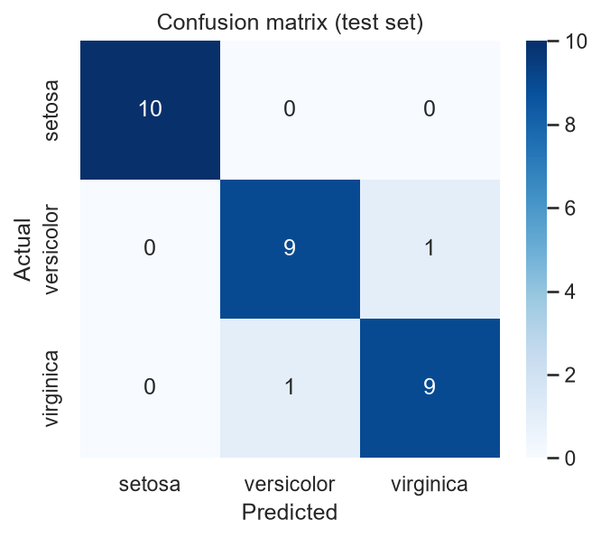

# Iris Flower Classification

Classifying iris flowers (setosa, versicolor, virginica) from their measurements using scikit-learn.

## Dataset
Iris dataset from Kaggle (150 samples, 4 features, 3 balanced classes).

## What I did
- Explored the data with a pairplot and summary statistics
- Engineered two features: petal area and sepal area
- Compared 5 models using 5-fold cross-validation
- Tuned the best model with GridSearchCV
- Visualised the data in 2D with PCA
- Analysed the misclassified flowers
- Built a `predict_flower()` function that shows confidence for each species

## Results
- Best model in cross-validation: SVM (96.7% CV accuracy)
- Final model: SVM tuned with GridSearchCV {'svc__C': 0.1, 'svc__gamma': 'scale', 'svc__kernel': 'linear'}
- Test accuracy: 93.3%
- Misclassified: 2 of 30 test flowers

## How to run
pip install -r requirements.txt
jupyter notebook

Open `iris_classification.ipynb` and run all cells.

## What I learned
- Train/test split and cross-validation
- Why scaling matters for KNN, SVM and Logistic Regression
- How to read a confusion matrix, precision and recall